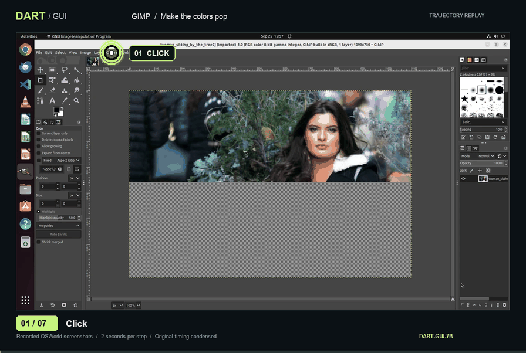

# DART-GUI · Project website

A Vue 3 research website for **Fully Decoupled Reinforcement Learning with Adaptive Data Curation for GUI Agents**. This is the website source branch of [Computer-use-agents/dart-gui](https://github.com/Computer-use-agents/dart-gui); model training and inference live on `main`.

[Project website](https://computer-use-agents.github.io/dart-gui/) · [Paper](https://arxiv.org/abs/2509.23866) · [Model](https://huggingface.co/PengxiangLi/dart-gui-7b)



## Run locally

Use Node.js 20 or newer. From this website checkout:

```sh
npm ci
npm run dev -- --host 127.0.0.1
```

Open the `/dart-gui/` URL printed by Vite. Port 5173 is the default; Vite selects another available port if it is busy.

```sh
npm run build
npm run preview -- --host 127.0.0.1 --port 4174 --strictPort
```

The production build is written to `dist/`. Its asset base is `/dart-gui/`, matching GitHub Pages. This website has no backend, API keys, font CDN, or third-party iframe requirements.

## What is included

- Responsive dark interface with a desktop scene, compact research metrics, and mobile navigation.
- Three locally hosted H.264 MP4 demos: photo color enhancement, presentation typography, and husky image resizing, with visual task previews.
- A step explorer with original screenshots, recorded reasoning, actions, action-location markers, keyboard navigation, and a scrubber.
- An interactive four-module architecture and the source paper figure.
- OSWorld results that switch between **30** and **100** maximum interactions, with exact per-domain numbers and equal-budget baseline comparisons.
- Full author information, source links, abstract, citation copying with a selection fallback, and social metadata.
- Reduced-motion support, visible keyboard focus, semantic controls, native video controls, and no automatic video playback.

## Demo assets

The MP4s are **screenshot replays assembled from archived real trajectories**, not new inference runs or screen recordings at the original execution speed. All recorded assistant actions are retained, including the terminal `finished` action. Each action is paired with its preceding observation and displayed for 2 seconds. The archive also contains one additional observation after termination; it is not counted as a new action.

| Asset                            | Content                                     | Duration          |
| -------------------------------- | ------------------------------------------- | ----------------- |
| `public/demos/vibrance.mp4`      | Enhance a photo's color saturation          | 14 s / 7 actions  |
| `public/demos/slides.mp4`        | Format the title of a blue-and-yellow slide | 18 s / 9 actions  |
| `public/demos/resize.mp4`        | Resize a husky photo to 512 px high         | 20 s / 10 actions |
| `public/demos/dart-gui-demo.gif` | Portable photo enhancement replay           | 14 s / 7 actions  |

The three featured MP4s total about 1 MB; the GIF is about 5 MB. Videos are user-initiated and preload only metadata. Screenshots and posters are WebP. High-contrast pulse rings and numbered action badges mark recorded clicks; drag arrows connect the recorded start and end coordinates, while keyboard shortcuts have a separate visible badge. These annotations are included in downloaded videos and the GIF. The page's source note distinguishes condensed replays from original timing. These examples come from the earlier project archive and are not reruns of the camera-ready experiments. Earlier demo files remain available at their existing URLs.

To regenerate videos and the GIF from the checked-in screenshots and manifest:

```sh
python3 -m venv .venv-media
. .venv-media/bin/activate
pip install -r scripts/requirements-media.txt
python scripts/generate_demos.py
```

To reimport the original locally supplied archive as well:

```sh
python scripts/generate_demos.py --source ../iclr-dart-page_1129/trajectories
```

The renderer uses FFmpeg from `imageio-ffmpeg` and a local system font (Arial or DejaVu Sans). It does not need GPU inference or external services.

## Editing and provenance

- `src/components/Main.vue`: page sections and interactions.
- `src/styles/`: responsive layout and section styling.
- `src/data.js`: reported results, authors, and BibTeX.
- `public/demos/manifest.json`: normalized trajectory content and source task IDs.
- `scripts/generate_demos.py`: reproducible video/GIF generation.
- [ASSETS.md](ASSETS.md): exact local sources, transformations, and reporting conventions.

The headline **43.28%** and **+15.76 percentage points** use the 100-step DART/base comparison from the supplied EMNLP camera-ready manuscript. At 30 steps, the corresponding figures are **42.05%** and **+17.88 percentage points**. Results describe the paper's experiments, not a current leaderboard. The paper's newer manuscript title and original arXiv citation are explicitly distinguished.

## Deployment

The existing GitHub workflow targets the `page` branch and deploys the built site. These local changes do not publish anything until they are integrated into that branch and pushed. Keep `base: '/dart-gui/'` in `vite.config.js` for the existing project URL. For a root-hosted preview, use `npm run build -- --base=/` instead.

## License

Website source: [MIT](LICENSE). Paper figures and recorded research assets are credited in [ASSETS.md](ASSETS.md).
